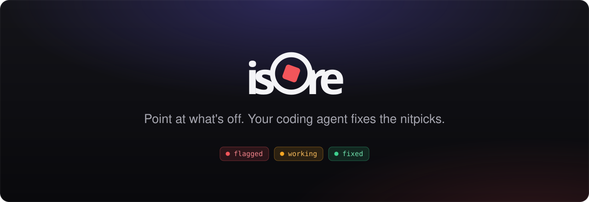
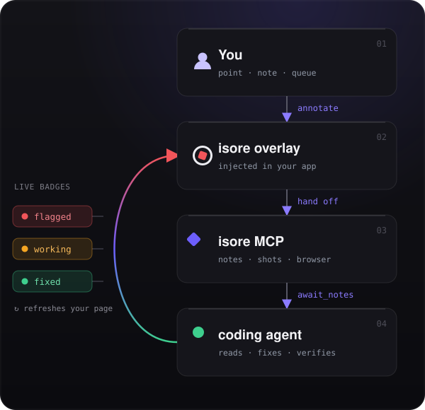

<p align="center">
  
</p>

<p align="center">
isore overlays your running web app so you can
  click any element, say what's wrong in plain language, and <strong>hand it off</strong> —
  your coding agent picks the notes up over MCP, fixes them, and your browser shows the
  progress live.
</p>

<p align="center">
  <a href="#install"></a>
  <a href="https://modelcontextprotocol.io"></a>
  <a href="LICENSE"></a>
  
</p>

## Contents

- [Why isore](#why-isore)
- [How it works](#how-it-works)
- [Install](#install)
- [Get started](#get-started)
- [The annotation workflow](#the-annotation-workflow)
- [MCP tools](#mcp-tools)
- [Configuration](#configuration)
- [FAQ](#faq)
- [Contributing](#contributing)
- [License](#license)

## Why isore

Design review is a game of telephone. You spot something off — a button a few pixels
low, a heading crammed against a card, text too faint to read — and then you _describe_
it: a screenshot pasted into Slack, a ticket, a paragraph explaining which paragraph you
mean. The agent that could fix it in seconds never sees what you saw.

**isore closes that loop.** Flag the element itself, in the running app, in plain
language. isore captures the boring context for you — the CSS selector, the element's
dimensions, a screenshot — and hands the whole batch to your coding agent. You watch the
fixes land live.

## How it works

<table class="cols">
<tr>
<td width="46%" valign="top">

</td>
<td width="54%" valign="top">

isore stands up a **reverse proxy** in front of your dev server and injects a small
overlay, built in a Shadow DOM so it can't collide with your app's styles — WebSockets
and your dev server's HMR stream pass through untouched.

You **point** at any element, drop a **note**, and let them **queue** up. One
**hand off** sends the batch to your agent over **MCP**; it reads each note — with the
selector, dimensions, and a screenshot — fixes the code, and marks it done.

Badges track every note live — **flagged → working → fixed** — and the page reloads
itself once the agent rebuilds.

</td>
</tr>
</table>

## Install

```sh
go install github.com/joaomdsg/isore/cmd/isore@latest
```

## Get started

**1. Register isore with your agent, once, from your project directory:**

```sh
claude mcp add isore -- isore mcp
```

**2. Ask your agent to start isore in front of your dev server:**

> _"start isore in front of my app on :3000 and fix my notes as I hand them off"_

That's all the setup there is. The MCP server ships its own instructions to the agent,
so it already knows the loop: stand up the proxy, open the annotated app in a driven
browser, wait for your hand-offs, fix each note, and reload your page when the build is
done. A window opens showing your app with the overlay ready.

**3. Toggle the overlay, flag what's off, and hand it off.** Badges turn amber while the
agent works and green with a summary when it's done — then the page refreshes itself.

## The annotation workflow

Every note carries its own state, shown as a badge pinned to the element and a row in
the overlay's inbox:

| Badge | State       | Meaning                                                     |
| :---: | ----------- | ----------------------------------------------------------- |
|  🔴   | **flagged** | You left a note; not yet handed off.                        |
|  🟠   | **working** | Handed off — the agent is on it. The overlay is frozen.     |
|  🟢   | **fixed**   | Done, with a one-line summary. The page reloads on rebuild. |

The overlay walks a simple path:

1. **Point** — toggle on; every element highlights as your cursor passes over it, with a
   devtools-style label showing its selector and size.
2. **Note** — click it and say what's off in plain language. isore auto-captures the
   selector, dimensions, and a screenshot.
3. **Queue** — flag as many as you want; they stack up numbered in the inbox.
4. **Hand off** — one tap sends the whole batch to your agent over MCP. The overlay
   **freezes** so nothing collides mid-fix.
5. **Fixed** — badges turn green with a summary; the overlay thaws and the page refreshes.

## MCP tools

Your agent doesn't just read your notes — it gets the browser.

### 🎮 Control

| Tool          | Description                                                                               |
| ------------- | ----------------------------------------------------------------------------------------- |
| `start_proxy` | Stand up the injecting proxy and open your browser. Start here; call again to move ports. |
| `reload_page` | Refresh your tabs after a rebuild (needs `start_proxy` first).                            |

### 📝 Notes

| Tool           | Description                             |
| -------------- | --------------------------------------- |
| `list_notes`   | List the current notes and their state. |
| `mark_working` | Badge turns amber; the overlay freezes. |
| `mark_fixed`   | Badge turns green; your summary shows in the overlay. |

Hand-offs aren't an MCP tool — the agent receives them by running the **`isore subscribe`** CLI as a single persistent background listener that streams every dispatched batch over one open SSE connection.

### 👀 Eyes

| Tool                 | Description                                          |
| -------------------- | ---------------------------------------------------- |
| `get_screenshot`     | The element PNG captured at hand-off.                |
| `browser_screenshot` | Capture the live page or an element to verify a fix. |

### ✋ Hands

| Tool               | Description                                                     |
| ------------------ | --------------------------------------------------------------- |
| `browser_eval`     | Run JS — read computed styles/state, click, type, drive the UI. |
| `browser_html`     | The live DOM.                                                   |
| `browser_navigate` | Go to a URL.                                                    |
| `browser_console`  | Logs, warnings, and errors.                                     |

The proxy runs **inside** the `isore mcp` server — no second process to manage. For the
element screenshots captured on every hand-off it attaches to your browser if one is
running, otherwise it launches its own headless Chromium.

## Configuration

Notes are written to `isore-out/notes.json`; every command takes `-out` to change the
store path. isore can also attach to a browser you already have open and drive it:

```sh
isore -url http://localhost:3000
```

| Flag          | Default                  | Description                                        |
| ------------- | ------------------------ | -------------------------------------------------- |
| `-url`        | `http://127.0.0.1:3000/` | App URL to open and annotate directly.             |
| `-out`        | `isore-out/notes.json`   | Where notes and screenshots are stored.            |
| `-debug-port` | `9222`                   | CDP port exposed to the `isore mcp` browser tools. |
| `-chrome`     | _auto-detect_            | Path to a specific browser executable.             |

Browser ↔ proxy is plain **HTTP + SSE**; the overlay reconciles authoritative note state
on every reconnect, so a dropped stream (tab closed, proxy restarted) heals itself.

## FAQ

**Does it change my app's styling?**
No. The overlay lives in a Shadow root; badges and outlines that attach to your elements
use scoped rules. Your app renders exactly as it would without isore.

**Does it work with hot reload?**
Yes — HMR and WebSocket traffic pass through the proxy untouched.

**What if I don't have Chrome/Chromium?**
isore falls back to your default browser and tells the agent to suggest installing one
for the fully-driven experience.

**Which agents are supported?**
Any MCP client. Setup shown here uses Claude Code (`claude mcp add`).

## Contributing

Issues and PRs are welcome. If you're building on the MCP surface, pin a commit — the
note schema may still evolve between versions.

## License

[MIT](LICENSE).

<p align="center"><sub>If isore saves you time, drop it a ⭐ — it helps others find it.</sub></p>
<p align="center">
  <a href="https://github.com/joaomdsg/isore"></a>
  &nbsp;&nbsp;
  <a href="https://github.com/joaomdsg"></a>
</p>
